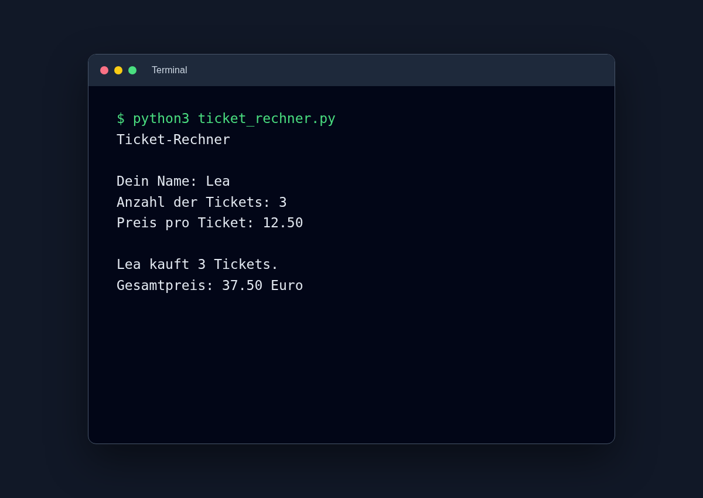

# Ticket-Rechner

## Dein Ziel

Baue einen kleinen Ticket-Rechner wie im Screenshot:



## Arbeitsauftrag

Erstelle `ticket_rechner.py`. Frage diese Werte ab:

- Name
- Anzahl der Tickets
- Preis pro Ticket

Wandle Anzahl und Preis in passende Datentypen um. Der Gesamtpreis entsteht aus der Anzahl der Tickets und dem Preis für ein Ticket. Gib Name, Ticketanzahl und Gesamtpreis mit einem f-String aus.

Das Prinzip der zwei Nachkommastellen an einem anderen Wert:

```python
temperature = 21.5
print(f"Temperatur: {temperature:.2f} °C")
```

## Fertig, wenn

- das Programm verschiedene Eingaben verarbeitet
- der Gesamtpreis richtig berechnet wird
- die Ausgabe Name, Anzahl und Preis enthält
