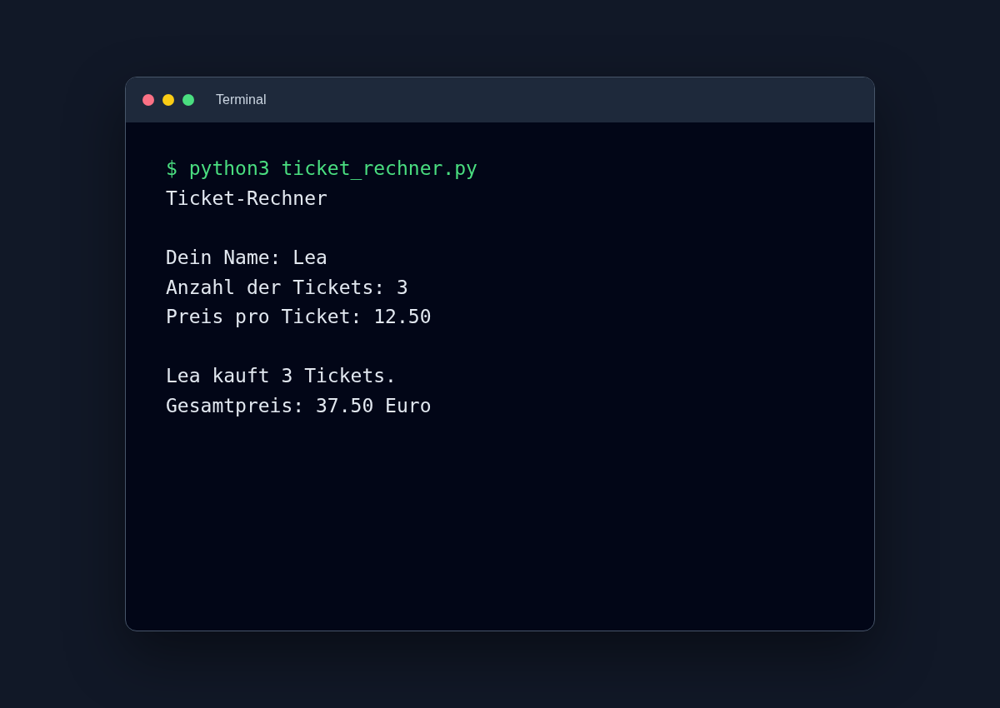

# Ticket Calculator

## Your goal

Build a small ticket calculator like the one in the screenshot:



## Task

Create `ticket_rechner.py`. Ask for these values:

- name
- number of tickets
- price per ticket

Convert the number and price to suitable data types. The total price is based on the number of tickets and the price of one ticket. Print the name, ticket count and total price using an f-string.

The principle of two decimal places using a different value:

```python
temperature = 21.5
print(f"Temperature: {temperature:.2f} °C")
```

## Done when

- the program handles different inputs
- the total price is calculated correctly
- the output contains the name, number and price
