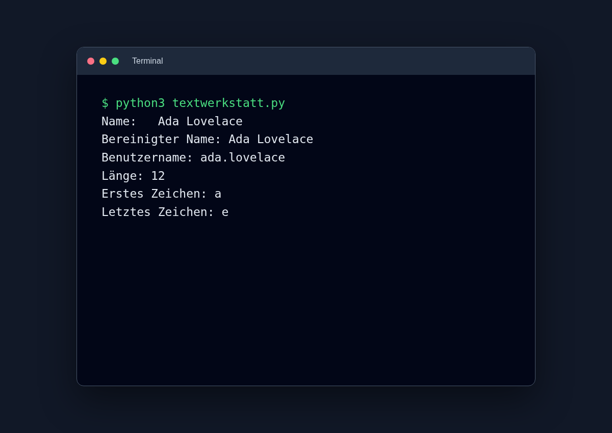

# Textwerkstatt

## Dein Ziel

Erzeuge aus einem eingegebenen Namen einen Benutzernamen:



## Beispiele zum Prinzip

```python
"  Hallo  ".strip()
"Python".lower()
"rot blau".replace(" ", "-")
len("Python")
"Python"[0]
"Python"[-1]
```

## Arbeitsauftrag

Erstelle `textwerkstatt.py`. Frage einen Namen ab und gib diese Werte aus:

- bereinigter Name ohne Leerzeichen am Rand
- Benutzername in Kleinbuchstaben und mit Punkten statt Leerzeichen
- Länge des Benutzernamens
- erstes und letztes Zeichen des Benutzernamens

Alle drei Auswertungen am Ende beziehen sich auf den fertigen Benutzernamen, nicht auf die ursprüngliche Eingabe.

Gib beim Testen mindestens ein Zeichen ein.

## Fertig, wenn

- der Benutzername keine Leerzeichen am Rand enthält
- Leerzeichen zwischen Wörtern durch Punkte ersetzt sind
- Länge, erstes und letztes Zeichen stimmen
