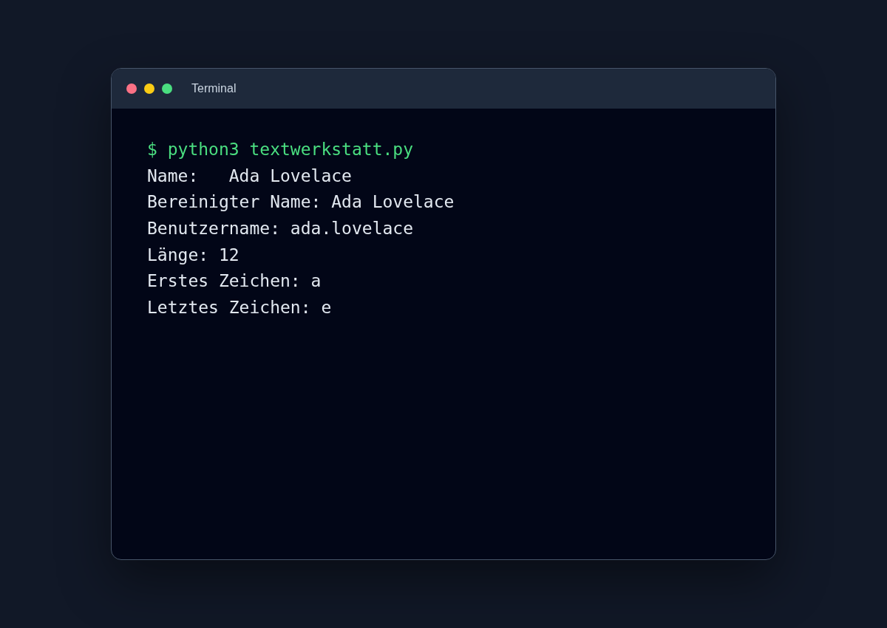

# Text Workshop

## Your goal

Create a username from an entered name:



## Examples of the principle

```python
"  Hello  ".strip()
"Python".lower()
"red blue".replace(" ", "-")
len("Python")
"Python"[0]
"Python"[-1]
```

## Task

Create `textwerkstatt.py`. Ask for a name and print these values:

- cleaned name without spaces at the edges
- username in lower case with dots instead of spaces
- length of the username
- first and last character of the username

All three checks at the end refer to the finished username, not the original input.

Enter at least one character when testing.

## Done when

- the username has no spaces at the edges
- spaces between words are replaced by dots
- length, first and last character are correct
