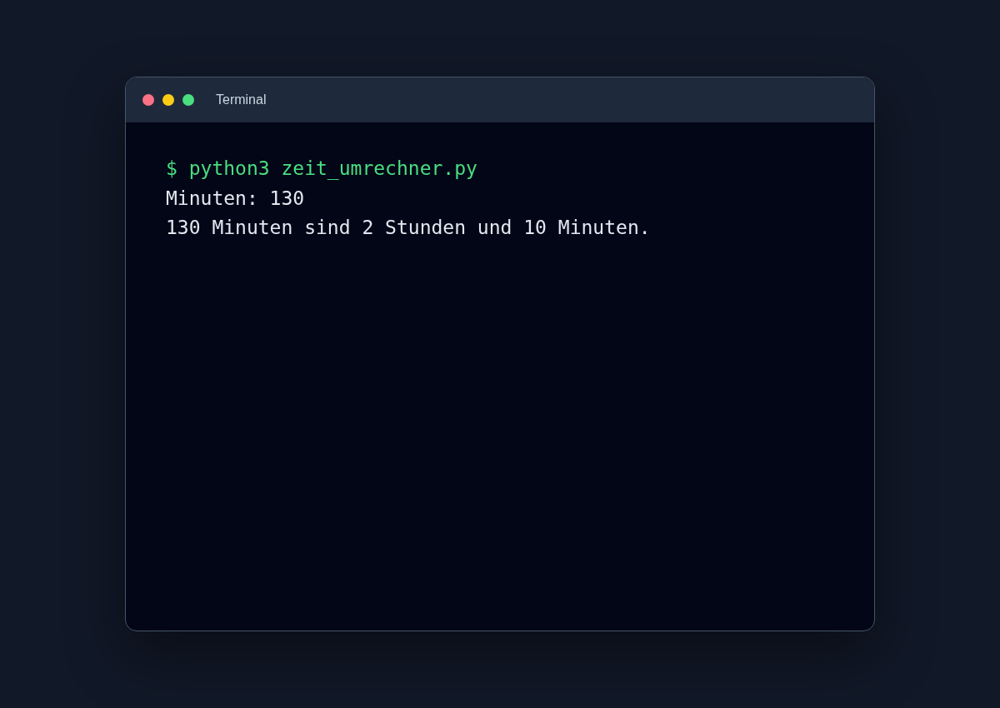

# Zeit-Umrechner

## Dein Ziel

Wandle Minuten in Stunden und Restminuten um:



## Beispiel zum Prinzip

```python
# 5 Personen passen in eine Gruppe, wir haben 17 Personen
people = 17
groups = 17 // 5  # 3 volle Gruppen
remain = 17 % 5   # 2 bleiben übrig
```

`//` berechnet vollständige Gruppen. `%` liefert den Rest. Übertrage dieses Prinzip auf die Zeitumrechnung.

## Arbeitsauftrag

Erstelle `zeit_umrechner.py`. Frage eine Anzahl Minuten ab, wandle sie in `int` um und berechne:

- wie viele vollständige Stunden mit jeweils 60 Minuten enthalten sind
- wie viele Minuten nach diesen vollständigen Stunden übrig bleiben

Gib das Ergebnis mit einem f-String aus.

## Fertig, wenn

- aus `130` Minuten `2 Stunden und 10 Minuten` werden
- auch andere positive Minutenzahlen funktionieren
