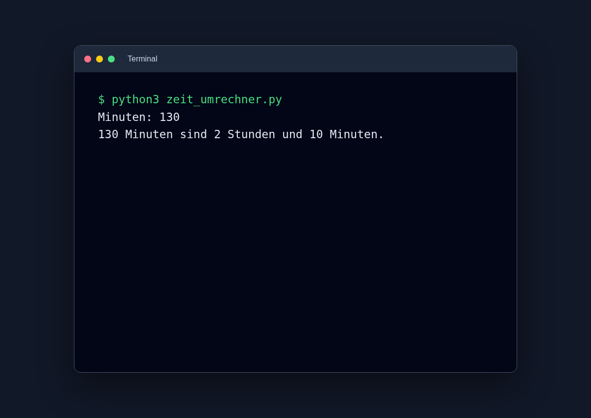

# Time Converter

## Your goal

Convert minutes into hours and remaining minutes:



## Example of the principle

```python
# 5 people are a complete group, we have 17 people
people = 17
groups = people // 5  # 3 complete groups
remain = people % 5   # 2 remain
```

`//` calculates complete groups. `%` returns the remainder. Transfer this principle to the time conversion.

## Task

Create `zeit_umrechner.py`. Ask for a number of minutes, convert it to `int` and calculate:

- how many complete 60-minute hours are included
- how many minutes remain after those complete hours

Print the result using an f-string.

## Done when

- `130` minutes becomes `2 hours and 10 minutes`
- other positive numbers of minutes work too
