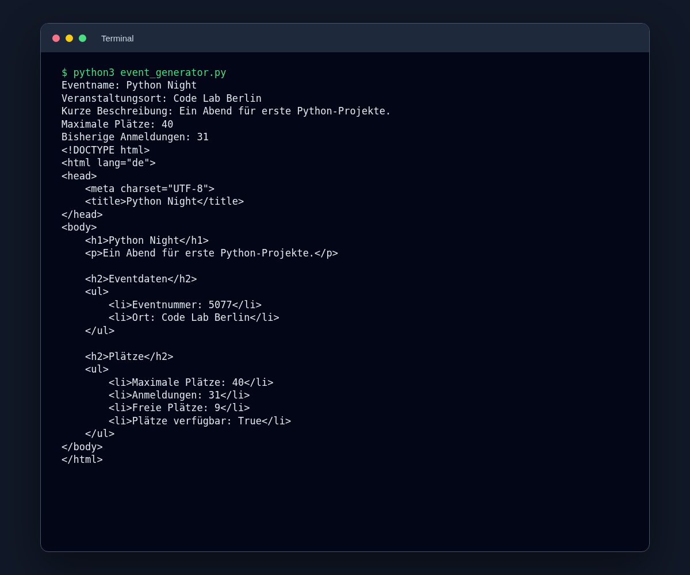

# Herausforderung: Event-Generator

## Dein Ziel

Erzeuge aus eigenen Eingaben eine vollständige Event-Seite als HTML-Code:



Im Bonus wird daraus eine Datei für den Browser:


## Zufällige Eventnummer

Das Modul `random` kann eine zufällige Zahl erzeugen:

```python
import random

event_number = random.randint(1000, 9999)
```

Die Eventnummer wird deshalb bei jedem Start anders sein.

## Mehrzeiliger f-String

```python
title = "Mein Event"

html = f"""
<h1>{title}</h1>
<p>Willkommen zu meinem Event!</p>
"""
```

## Arbeitsauftrag

Erstelle `event_generator.py` und frage diese Daten ab:

- Eventname
- Veranstaltungsort
- kurze Beschreibung
- maximale Anzahl der Plätze
- bisherige Anmeldungen

Nutze dein Wissen aus den vorherigen Aufgaben und berechne:

- freie Plätze
- den Boolean `places_available`
- eine zufällige vierstellige Eventnummer

Setze alle Werte in ein vollständiges HTML-Dokument ein. Nutze mindestens `title`, `h1`, `h2`, `p`, `ul` und `li`. Gib den fertigen HTML-String mit `print(html)` im Terminal aus.

Gib beim Testen nicht mehr Anmeldungen als Plätze ein.

## Bonus: HTML-Datei erzeugen

Füge diesen Code nach `print(html)` ein:

```python
with open("event.html", "w", encoding="utf-8") as file:
    file.write(html)
```

Starte das Programm erneut und öffne danach `event.html` im Browser. Dieser Code ist ein Ausblick und muss heute noch nicht erklärt werden.

## Fertig, wenn

- deine Eingaben im HTML-Code erscheinen
- freie Plätze und Boolean richtig berechnet werden
- die Eventnummer vier Stellen hat
- der Bonus eine funktionierende `event.html` erzeugt
