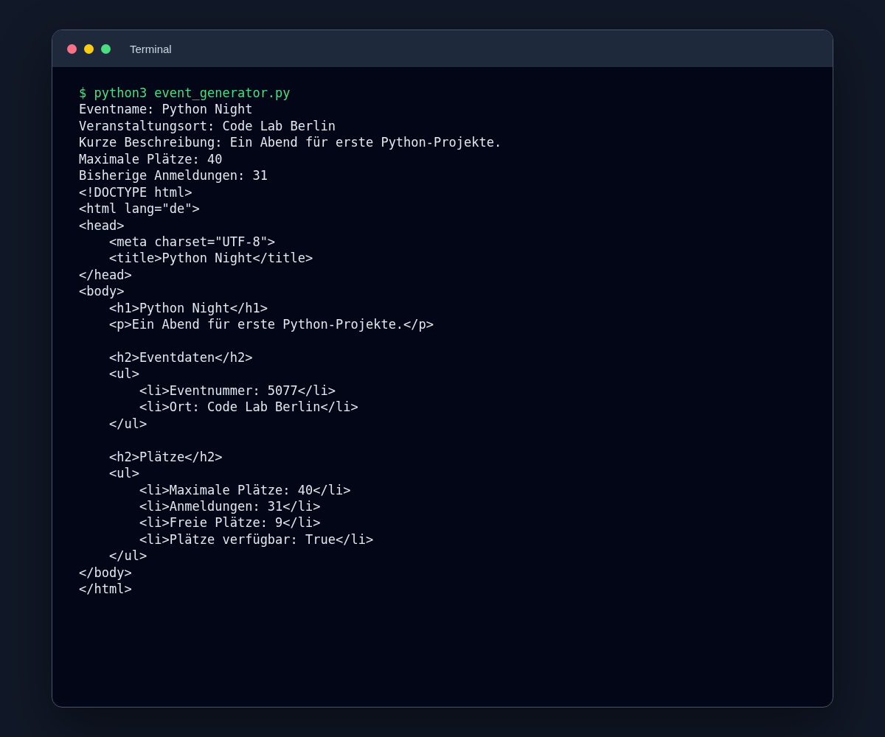
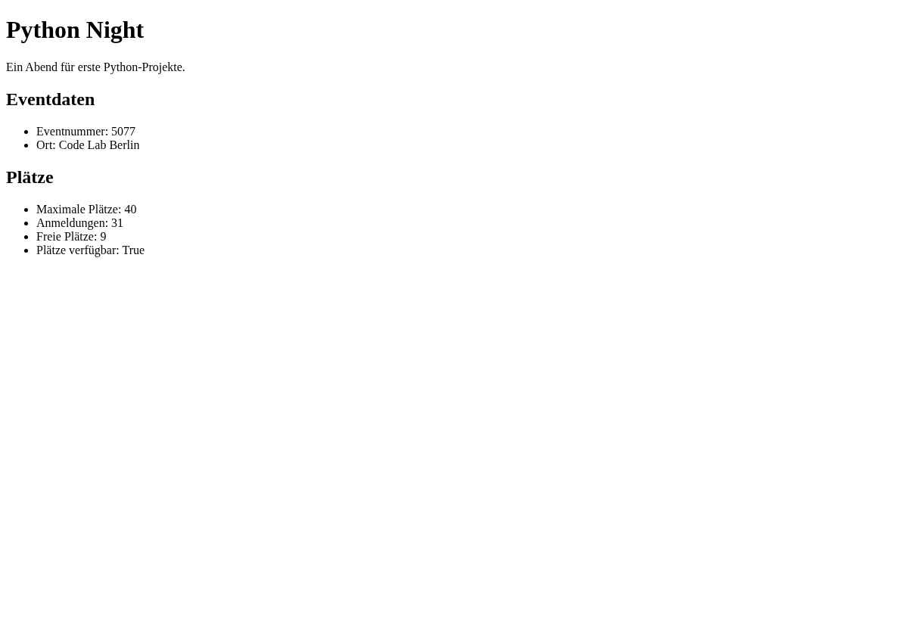

# Challenge: Event Generator

## Your goal

Use your own input to create a complete event page as HTML code:



The bonus turns it into a file for the browser:



## Random event number

The `random` module can generate a random number:

```python
import random

event_number = random.randint(1000, 9999)
```

The event number will therefore be different each time the program runs.

## Multiline f-string

```python
title = "My Event"

html = f"""
<h1>{title}</h1>
<p>Welcome to my event!</p>
"""
```

## Task

Create `event_generator.py` and ask for this data:

- event name
- venue
- short description
- maximum number of places
- current registrations

Use your knowledge from the previous tasks to calculate:

- free places
- the Boolean `places_available`
- a random four-digit event number

Insert all values into a complete HTML document. Use at least `title`, `h1`, `h2`, `p`, `ul` and `li`. Print the finished HTML string in the terminal using `print(html)`.

When testing, do not enter more registrations than places.

## Bonus: create an HTML file

Add this code after `print(html)`:

```python
with open("event.html", "w", encoding="utf-8") as file:
    file.write(html)
```

Run the program again and then open `event.html` in the browser. This code is a preview and does not need to be explained today.

## Done when

- your input appears in the HTML code
- free places and the Boolean are calculated correctly
- the event number has four digits
- the bonus creates a working `event.html`
